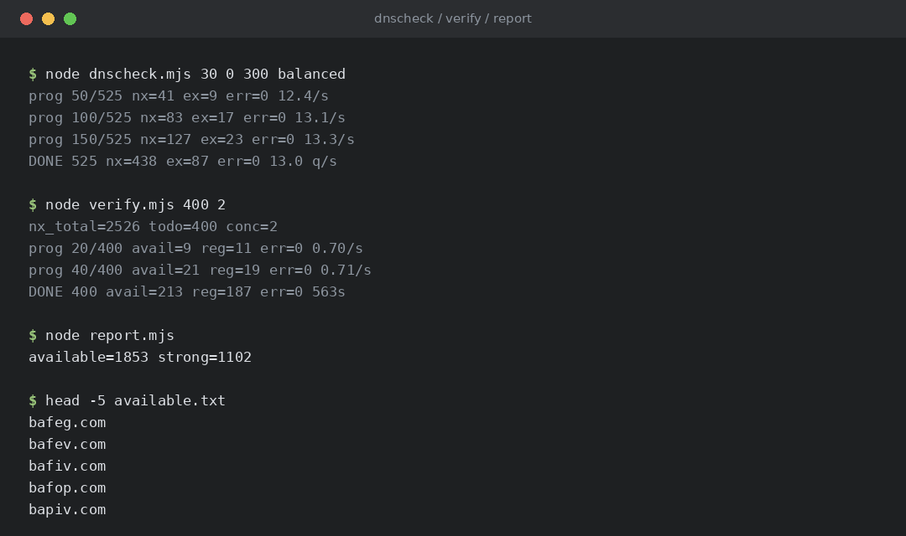

# CVCVC Domain Scan

扫描 **5 字母 CVCVC 结构**的 `.com` 可注册域名。

CVCVC = 辅音-元音-辅音-元音-辅音（如 `guvek`、`vatib`、`zepab`）。
全部组合为 21 × 5 × 21 × 5 × 21 = **229,114** 个（已过滤不雅词），适合找短、能读、有品牌感的域名。

## 工作流

1. **生成 + 评分** — `gen.mjs` 枚举全部 CVCVC，按字母多样性、软辅音占比、元音变化等做启发式打分。
2. **DNS 预筛** — `dnscheck.mjs` 通过 DoH（阿里 AliDNS + doh.pub）查 NS，筛出 NXDOMAIN 候选，避开逐个大流量 RDAP 查询。
3. **RDAP 精查** — `verify.mjs` 向 Verisign RDAP 查询：`404` = 可注册，`200` = 已注册。
4. **汇总输出** — `report.mjs` 合并两轮验证结果，生成 `available.txt` / `available.csv` / `report.md`。
5. **可选审美排序** — `beauty.mjs` 做更严格的读音/字母组合评分，`curate.mjs` 按首字母均衡挑选。

## 环境

- Node.js **18+**（依赖内置 `fetch`）
- 无需任何 API key

## 用法

```bash
# 1) DNS 预筛
#    参数: 并发 起始 数量 [slice|balanced]
node dnscheck.mjs 30 0 300 balanced

# 2) RDAP 精查
#    参数: 最多检查多少个 并发
node verify.mjs 400 2

# 3) 汇总
node report.mjs

# 可选
node beauty.mjs
node curate.mjs
```

默认把结果写到当前目录，也可以用环境变量指定：

```bash
DOMAINSCAN_DIR=/path/to/out node dnscheck.mjs 30 0 300 balanced
```

## 输出文件

| 文件 | 内容 |
| --- | --- |
| `dns.jsonl` | 每个候选的 DNS 状态（nx / exists / err）与评分 |
| `verified.jsonl` | RDAP 精查结果（available / registered / error） |
| `available.txt` | 最终可注册域名，一行一个，可直接导入注册商批量查询 |
| `available.csv` | 域名、评分、tier、验证来源 |
| `report.md` | 可读报告（Strong / Rest 分层） |
| `ranked.txt` | beauty.mjs 的审美排序 |

## 实测结果（2026-11-21）

- 生成候选：229,114
- DNS 预筛：27,131
- NXDOMAIN 候选：2,526
- RDAP 精查：2,670
- **确认可注册：1,853**

手选示例（RDAP 复核 404）：`guvek.com`、`vatib.com`、`zepab.com`、`jateg.com`、`tebif.com`

## 示例输出



完整结果快照见 `example/`：

- `example/available-2026-11-21.txt` — 1,853 个可注册域名
- `example/available-2026-11-21.csv` — 带评分与验证来源

## 注意

- NXDOMAIN 只是预筛信号，最终能否注册必须以 **RDAP 或注册商实时查询** 为准。
- Verisign RDAP 有速率限制，脚本默认每次请求后等待 700 ms，并对 429 做退避；不要随意加大并发。
- 国内网络访问 `dns.google` 不稳定，脚本默认使用 `dns.alidns.com` 和 `doh.pub`。
- 好域名的可注册状态变化很快，看中建议尽快下手。
- 请遵守各服务的使用条款，不要用于批量囤积或滥用。

## License

MIT
